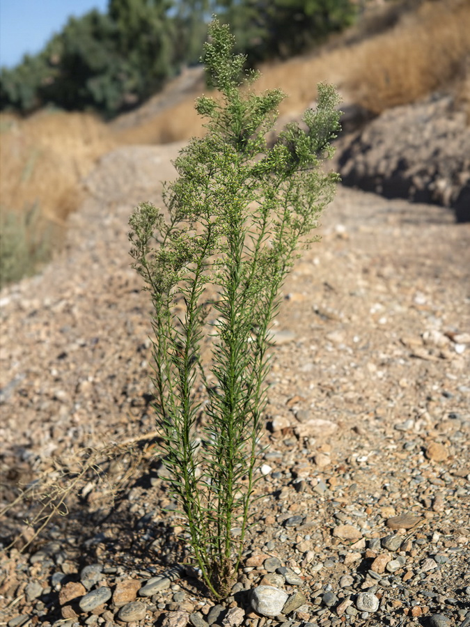

# Parte 1. Del DNA a los SNPs

## 1.0. Introducción
En esta primera parte de la práctica seguiremos el flujo general de un experimento de **ddRAD-seq**, desde las lecturas de secuenciación hasta la obtención de un archivo **VCF** (*Variant Call Format*) que contiene información sobre variantes genéticas.

El objetivo no es solamente aprender a ejecutar programas bioinformáticos, sino comprender **qué información entra, qué proceso se realiza y qué información sale de cada etapa**.

El flujo general será:

```text
DNA
 ↓
Digestión con enzimas de restricción
 ↓
Selección de fragmentos
 ↓
Ligación de adaptadores y códigos de barras
 ↓
Secuenciación Illumina
 ↓
FASTQ
 ↓
Control de calidad
 ↓
Procesamiento de ddRAD-seq
 ↓
Identificación y ensamblaje de loci
 ↓
Llamado de SNPs
 ↓
Filtrado de variantes
 ↓
VCF
```

Utilizaremos los datos generados en el artículo de Lucas et al. (2026), *Population genomics of a cosmopolitan weed provides insights into its local adaptation and recent demographic history*, para reproducir parcialmente los principales resultados.

El estudio analizó 640 individuos de **_Erigeron canadensis_** (Asteraceae), una especie de planta herbácea con un área de distribución nativa amplia en Norteamérica y con poblaciones no nativas establecidas en Eurasia. Los autores emplearon herramientas de genómica de poblaciones y genómica del paisaje para investigar sus patrones de variación genética y su historia demográfica.



Artículo: [Lucas et al. (2026)](https://onlinelibrary.wiley.com/doi/full/10.1111/mec.70368)

---

## 1.1. Genómica de poblaciones y genómica del paisaje

La **genómica de poblaciones** estudia cómo se distribuye la variación genética dentro y entre poblaciones. Para ello utiliza numerosos marcadores distribuidos a lo largo del genoma, lo que permite investigar procesos como la diferenciación genética, el flujo génico, la historia demográfica y la estructura poblacional.

La **genómica del paisaje** integra la información genética con variables geográficas y ambientales. Su objetivo es explorar cómo factores como la distancia geográfica, el clima, la topografía o la fragmentación del hábitat se relacionan con la distribución de la variación genética. [Aquí](https://www.sciencedirect.com/science/article/pii/S0169534703000089) un artículo sobre las bases conceptuales de esta discliplina.

Por ejemplo, podemos plantear las siguientes preguntas:
- ¿Los individuos de regiones geográficamente cercanas son genéticamente más similares?
- ¿Existen diferencias genéticas entre las regiones nativas y no nativas?
- ¿La variación genética está asociada con gradientes ambientales?
- ¿Qué procesos históricos y ecológicos podrían explicar los patrones observados?

Para abordar estas preguntas necesitamos obtener marcadores genéticos de los individuos y relacionarlos posteriormente con información geográfica y ambiental.


## 1.2. ¿Qué es RAD-seq?

RAD-seq (*Restriction site-Associated DNA sequencing*) es una estrategia de secuenciación que permite estudiar una fracción del genoma utilizando enzimas de restricción.

La idea general es:

1. El DNA se corta utilizando enzimas que reconocen secuencias específicas.
2. Se seleccionan determinados fragmentos de DNA.
3. Se añaden adaptadores que permiten amplificar y secuenciar los fragmentos.
4. Se incorporan identificadores moleculares, como códigos de barras, para distinguir las muestras cuando corresponda.
5. Los fragmentos se secuencian.
6. Las lecturas se procesan para identificar regiones homólogas del genoma y detectar variantes genéticas.


## 1.3. ¿Qué es ddRAD-seq?

En esta práctica trabajaremos específicamente con **ddRAD-seq** (*double-digest RAD-seq*).

A diferencia de otros enfoques de representación de genomas reducidos que utilizan una sola enzima para definir los sitios de restricción, ddRAD-seq utiliza una combinación de dos enzimas. Esto permite definir los extremos de los fragmentos recuperados y seleccionar una fracción del genoma mediante criterios como el tamaño de los fragmentos.


    Pregunta: ¿Por qué puede ser útil estudiar solamente una fracción del genoma en lugar de secuenciar el genoma completo de todos los individuos?

#### Diseño expermiental del artículo de Lucas et al. (2026):
"We used a modified version of the ddRADseq protocol of Peterson et al. (2012) to construct reduced-representation libraries of genomic DNA for the genotyping of single nucleotide polymorphisms (SNPs) as described in Durka et al. (2025). In short, approximately 200 ng of DNA from each sample was digested with EcoRI-HF and MspI using Cutsmart buffer (NEB). Custom-barcoded adapters were then ligated to restriction fragments. Groups of 96 samples, each with a unique barcode, were pooled, purified with the Promega-Wizard Gel and PCR Clean-up Kit, and size-selected using the BluePippin (Sage Science) electrophoresis platform to select target fragments of 350 to 450 bp in length. Unique external indices were added to each pool through PCR amplification. The PCR products were purified with the Promega Clean-up kit and AMPure XP beads. Fragment sizes were verified on an Agilent 2100 Bioanalyzer. Libraries were then pooled in equimolar quantities and sequenced using the Illumina NovaSeq 6000 Sequencing System with 10% PhiX."


## 1.4. De la biblioteca ddRAD a las lecturas FASTQ

Después de construir la biblioteca ddRAD, los fragmentos seleccionados se secuencian. En el estudio que utilizaremos se empleó secuenciación Illumina.

El secuenciador no produce directamente una tabla de genotipos. Produce **lecturas de secuenciación**, es decir, secuencias de nucleótidos acompañadas de una estimación de la calidad de cada base. Estas lecturas se almacenan habitualmente en **archivos FASTQ**.

Como nuestros datos son paired-end, cada fragmento secuenciado puede estar representado por dos lecturas:

- **R1:** lectura obtenida desde uno de los extremos del fragmento.
- **R2:** lectura obtenida desde el extremo opuesto.


Esta correspondencia será importante durante el procesamiento bioinformático: si R1 y R2 dejan de estar correctamente emparejadas, algunos programas no podrán reconstruir adecuadamente la información de los fragmentos.

## 1.5. Obtención de los datos

Los datos de secuenciación del estudio están disponibles públicamente en el bioproyeto **PRJEB91610**.

Puedes consultar los registros en [European Nucleotide Archive (ENA)](https://www.ebi.ac.uk/ena/browser/view/PRJEB91610).

En esta práctica descargaremos únicamente dos muestras. Esto reduce el tiempo de procesamiento y permite trabajar con los datos durante una sesión de clase.

### 1.5.1. Descargar los datos

Desde la raíz del repositorio, entra al directorio de scripts:

```bash
cd bin/
```

Inspecciona el script de descarga antes de ejecutarlo:

```bash
nano 01-Get-data.sh
```

**¿Por qué inspeccionamos el script?**

Antes de ejecutar un programa, conviene saber qué archivos descargará, dónde los guardará y qué comandos utilizará. Leer los scripts también ayuda a detectar rutas incorrectas o descargas innecesariamente grandes.

Ejecuta el script:

```bash
bash 01-Get-data.sh
```

Regresa a la raíz del repositorio cuando sea necesario:

```bash
cd ..
```

Comprueba que los archivos se hayan descargado:

```bash
ls -lh data/raw/
```

En nuestro conjunto de práctica esperamos encontrar los archivos correspondientes a las dos muestras seleccionadas:

```text
ERR15191538.1.fastq.gz
ERR15191538.2.fastq.gz
ERR15191667.1.fastq.gz
ERR15191667.2.fastq.gz
```

Los sufijos `.1` y `.2` identifican las dos lecturas paired-end de cada muestra.

### 1.5.2. Inspeccionar un archivo FASTQ

Un archivo FASTQ contiene cuatro líneas por lectura:

```text
@READ_ID
ACGTGCTAGCTAGCTAGCTA
+
FFFFFFFFFFFFFFFFFFFF
```

Estas líneas representan:

1. **Identificador:** permite reconocer la lectura.
2. **Secuencia:** las bases de DNA observadas.
3. **Separador:** delimita la secuencia y la información de calidad.
4. **Calidad:** valores codificados que representan la confianza del secuenciador en cada base.


Inspecciona las primeras lecturas de una muestra:

```bash
zcat data/raw/ERR15191538.1.fastq.gz | head -n 20
```

El comando `zcat` permite leer archivos comprimidos con gzip sin descomprimirlos permanentemente. `head -n 20` muestra las primeras 20 líneas, equivalentes a cinco registros FASTQ completos.

Para examinar la lectura correspondiente del otro extremo, cambia `.1` por `.2` en la ruta.

---

## 1.6. Control de calidad de los datos

Antes de procesar las lecturas debemos evaluar su calidad.

Para ello utilizaremos **FastQC** y **MultiQC**.

FastQC genera un informe por archivo que resume distintas características de las lecturas, entre ellas:

- Calidad por posición.
- Distribución de la calidad.
- Contenido de GC.
- Distribución de la longitud de las lecturas.
- Secuencias sobre-representadas.
- Posible presencia de adaptadores.

MultiQC reúne los informes de múltiples archivos en un único reporte, facilitando la comparación entre muestras y entre lecturas R1 y R2.

### 1.6.1. Ejecutar el control de calidad

Inspecciona el script:

```bash
nano bin/02-Quality.Control.sh
```

Ejecuta el análisis:

```bash
bash bin/02-Quality.Control.sh
```

Después, localiza y abre el reporte HTML de MultiQC generado por el script.

### 1.6.2. ¿Cómo interpretar el reporte?

Los resultados de FastQC deben interpretarse considerando el tipo de biblioteca y el diseño experimental. [Aquí](https://hbctraining.github.io/Training-modules/planning_successful_rnaseq/lessons/QC_raw_data.html) una guía para interpretar el reporte de fastqc.


Debemos identificar si existen problemas que puedan afectar los análisis posteriores, como una pérdida marcada de calidad en los extremos de las lecturas, presencia de adaptadores o diferencias importantes entre archivos.

    Preguntas:

    1. ¿La calidad cambia a lo largo de la longitud de las lecturas?
    2. ¿Las lecturas R1 y R2 presentan patrones similares?
    3. ¿Hay indicios de adaptadores u otras secuencias sobre-representadas?


---

## 1.7. Procesamiento de lecturas y ensamblaje de loci con Stacks

En esta práctica utilizaremos [Stacks v2.68](https://catchenlab.life.illinois.edu/stacks/) para procesar las lecturas y obtener una matriz de variantes genéticas.

Stacks es un conjunto de herramientas diseñado para trabajar con datos de secuenciación de sitios de restricción, como RAD-seq y ddRAD-seq. [Aquí](https://catchenlab.life.illinois.edu/stacks/manual/) el manual del programa. 

Nuestro flujo utiliza principalmente tres componentes:

- `process_radtags`: procesa las lecturas y aplica filtros iniciales.
- `denovo_map.pl`: coordina el ensamblaje de loci, la construcción del catálogo, la asociación de loci entre muestras y el genotipado.
- `populations`: aplica filtros poblacionales y permite exportar los resultados, por ejemplo, en formato VCF.

En este ejercicio utilizaremos un ensamblaje *de novo*, es decir, **no partiremos de un genoma de referencia para localizar las lecturas**. Los loci se identifican mediante la similitud entre las lecturas y se comparan entre los individuos.

### Paso 1. Procesamiento de las lecturas con `process_radtags`

Ejecuta el script:

```bash
bash bin/03-a-Stacks_process_radtags.sh
```

Inspecciona el script antes de ejecutarlo para identificar los archivos de entrada, el directorio de salida y los parámetros utilizados.

`process_radtags` procesa las lecturas de secuenciación y puede realizar operaciones como el demultiplexado, la comprobación de sitios de restricción, el filtrado de lecturas de baja calidad y la eliminación de lecturas que no cumplen los criterios establecidos.


#### ¿Qué archivos obtenemos?

El script genera archivos FASTQ procesados y registros de ejecución. El nombre y la ubicación exactos dependen de las opciones especificadas en el script.

Inspecciona los archivos resultantes:

```bash
find data/stacks -maxdepth 2 -type f
```

### Paso 2. Normalización de los encabezados FASTQ

Durante la ejecución de este pipeline, encontré un un problema de compatibilidad al intentar ensamblar los datos paired-end con Stacks 2.68.

Aunque los archivos R1 y R2 tenían el mismo número de lecturas y sus identificadores coincidían, `tsv2bam` no conseguía encontrar las lecturas pareadas correspondientes.

Al revisar los encabezados, observé que contenían información adicional después del identificador principal. Por lo que, para este conjunto de datos, normalizamos los encabezados antes de proceder con el ensamblaje.

El siguiente código crea copias de los FASTQ procesados con encabezados simplificados. Puedes ejecutarlo directo en la terminal:

```bash
mkdir -p data/stacks/process_radtags_fixed 

for sample in ERR15191538 ERR15191667; do
    for mate in 1 2; do
        zcat "data/stacks/${sample}.${mate}.fq.gz" |
        awk -v mate="$mate" '
            NR % 4 == 1 {
                id = $1
                sub(/^@/, "", id)
                sub(/\/[12]$/, "", id)
                print "@" id "/" mate
                next
            }
            { print }
        ' | gzip -c > "data/stacks_paired_fixed/${sample}.${mate}.fq.gz"
    done
done
```

#### ¿Qué hace este código?

- `mkdir -p` crea el directorio de salida si todavía no existe.
- `zcat` lee los archivos comprimidos.
- `awk` identifica las líneas de encabezado, que son la primera línea de cada registro FASTQ.
- `$1` extrae el primer campo del encabezado, delimitado por espacios.
- `sub(/^@/, "", id)` elimina el símbolo inicial `@`.
- `sub(/\/[12]$/, "", id)` elimina un sufijo `/1` o `/2` si ya está presente.
- `print "@" id "/" mate` escribe el identificador seguido del sufijo correspondiente al mate.
- `gzip -c` comprime el resultado sin modificar el archivo original.

El script conserva las líneas de secuencia, separador y calidad. La modificación se limita a los encabezados.

Por ejemplo, un encabezado como:

```text
@ERR15191538.1 A00709:533:HLWY5DSX5:4:1101:12319:1031 length=143/1
```

se transforma en:

```text
@ERR15191538.1/1
```

La pareja R2 conserva el identificador principal y termina en `/2`.

Esta normalización resolvió el problema en nuestro conjunto de práctica. Sin embargo, no debe considerarse un paso obligatorio para todos los datos de Stacks.

### Paso 3. Ensamblaje de loci y genotipado

Con los archivos listo, ejecutaremos el enamblado:

```bash
bash bin/03-b-Stacks_denovo-assembly.sh
```

En este flujo, `denovo_map.pl` coordina varias etapas:

| Programa | Función |
|---|---|
| `ustacks` | Agrupa lecturas de un mismo individuo con secuencias idénticas o similares para identificar loci únicos y construir los stacks de lecturas. También identifica posibles alelos y, según los parámetros, lecturas de baja cobertura. |
| `cstacks` | Construye un catálogo de loci a partir de los loci identificados en los individuos seleccionados y establece correspondencias entre ellos. |
| `sstacks` | Compara los loci de cada individuo con el catálogo para identificar y asociar los loci homólogos. |
| `tsv2bam` | Reorganiza la información de los loci y las lecturas asociadas en archivos BAM, recuperando y organizando las lecturas paired-end cuando se dispone de ellas. |
| `gstacks` | Integra la información de los loci y las lecturas, utiliza las lecturas paired-end cuando están disponibles y realiza el genotipado. En datos de novo, también puede construir modelos de loci y resolver haplotipos a partir de las lecturas. |
| `populations` | Calcula estadísticas de variación genética a partir de los genotipos, aplica filtros poblacionales y genera estadísticas y archivos de salida para análisis posteriores. |

El conjunto de parámetros determina qué tan estrictamente se agrupan las lecturas y se relacionan los loci entre individuos. Por ejemplo, `-M` y `-n` controlan distancias de agrupamiento en diferentes etapas del ensamblado. [Aquí](https://pubmed.ncbi.nlm.nih.gov/24916682/) una discusión sobre por qué es importante estos parámetros y qué efectos tienen en los análisis subsecuentes. 


#### ¿Qué debemos revisar?

Al finalizar, comprueba que el registro de `denovo_map.pl` muestre que las etapas principales terminaron correctamente.

También identifica:

- El número de loci ensamblados por individuo.
- El tamaño final del catálogo.
- La proporción de lecturas pareadas recuperadas.
- El número de loci genotipados.

```bash
cat data/stacks/Denovo_M2_n2/denovo_map.log
```

---

## Paso 4. Exportación y filtrado de variantes: `populations`

Una vez completado el ensamblado y el genotipado, utilizaremos `populations` para generar archivos que puedan utilizarse en análisis posteriores.

Stacks ejecuta `populations` automáticamente como parte de `denovo_map.pl`. Sin embargo, hacerlo de forma independiente permite especificar filtros y formatos de salida diferentes sin repetir todo el ensamblaje.


```bash
bash bin/03-c-Stacks_populations.sh
```

Este script toma como entrada los resultados del ensamblaje y el archivo que asocia cada muestra con su respectiva población (`metadata/popMap.txt`).


### ¿Qué es un VCF?

VCF (*Variant Call Format*) es un formato de archivo utilizado para almacenar variantes genéticas y los genotipos de los individuos.

Entre sus campos se encuentran:

- `CHROM`: identificador de la secuencia o región.
- `POS`: posición de la variante dentro de esa secuencia.
- `REF`: alelo de referencia.
- `ALT`: alelo o alelos alternativos.
- `QUAL`: calidad asociada con la variante.
- `FILTER`: estado de los filtros aplicados.
- `INFO`: información adicional sobre la variante.
- `FORMAT`: descripción de los campos de genotipo.
- Columnas de muestras: genotipos de los individuos.

En un ensamblaje *de novo*, los identificadores de secuencia y las posiciones del VCF corresponden a las secuencias de referencia construidas por el flujo y no a posiciones de un cromosoma de un genoma de referencia externo.

Un VCF puede contener genotipos como `0/0`, `0/1` y `1/1` para individuos diploides. Estos representan, respectivamente, dos copias del alelo de referencia, una copia de cada alelo y dos copias del alelo alternativo, siempre que esos genotipos estén codificados de esa forma en el archivo.

### Filtrado de SNPs

El programa `populations` permite aplicar criterios para decidir qué loci o variantes se conservarán.

Por ejemplo, `-R` establece la proporción mínima de individuos del conjunto global en los que debe estar presente un locus. Otros parámetros permiten controlar la presencia por población, la frecuencia alélica y la profundidad de genotipado. Revisa las opciones en el manual.


### Comprobar el resultado

Después de ejecutar el script, inspecciona el directorio de salida y confirma que el archivo VCF se haya generado.

```bash
find data/stacks/populations_R70 -maxdepth 1 -type f
```

El VCF generado en esta etapa constituye la salida principal de la Parte I. En la Parte II utilizaremos la matriz genómica completa publicada por los autores para desarrollar los análisis ecológicos y de genómica de poblaciones.

---

## 1.9. Síntesis: del DNA a los SNPs

En esta práctica recorrimos las principales etapas de un flujo de análisis de ddRAD-seq:

1. Descargamos lecturas de secuenciación.
2. Inspeccionamos los archivos FASTQ.
3. Evaluamos la calidad de las lecturas.
4. Procesamos las lecturas con `process_radtags`.
5. Preparamos los encabezados paired-end para resolver una incompatibilidad observada.
6. Ensamblamos loci y realizamos el genotipado con Stacks.
7. Exportamos variantes mediante `populations`.

### FIN
